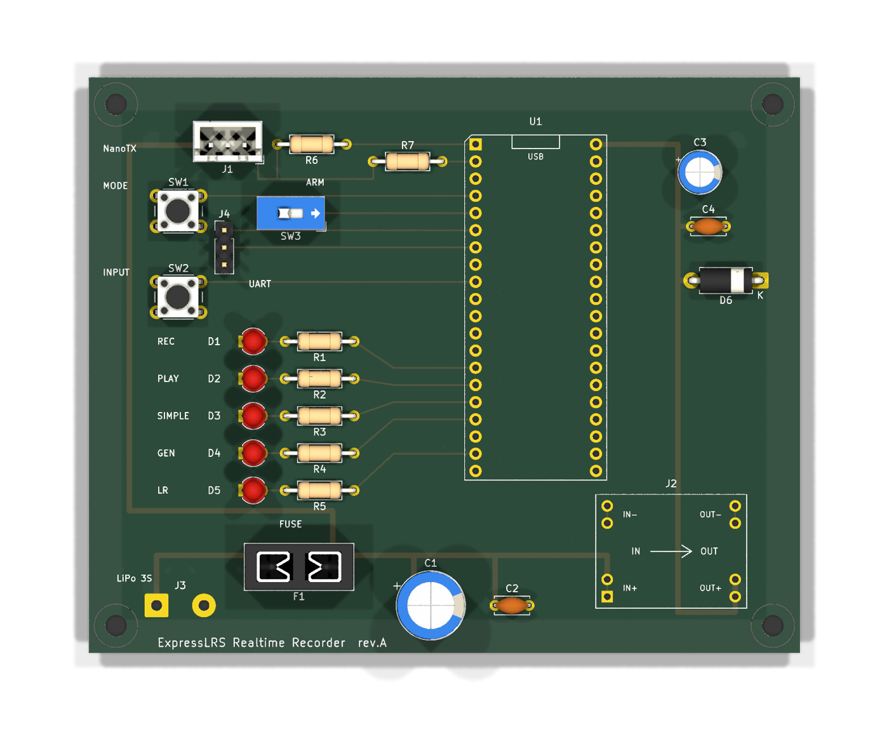

# 回路図 / 基板（KiCad 9）

`recorder.kicad_pro` を KiCad で開く。KiCad無しで見る／印刷する用に
`recorder.pdf`（回路図）と `pcb-fab.pdf`（基板の表面・1:1）。



## 基板の概要

- **105 × 85 mm / 2層 / 全てスルーホール**（初めての基板をハンダ付け1工程で組めるように）
- **裏面は全面GNDベタ**。全部品がスルーホールなのでGNDパッドはベタに直結し、
  GND用の配線もビアも1本も無い。表面の信号配線は**ビア0**。
- Picoの**左列に繋がる部品は左側、右列(VBUS)は右側**に置き、Picoを跨ぐ配線を無くした。
  さらに左側の部品は**Picoのピンと同じY座標**に並べてあるので、配線は水平一直線で
  交差しない。

## 検証状況

| 対象 | 結果 |
|---|---|
| 回路図 ERC | **エラー0 / 警告0** |
| ネットリスト | 全ネットの結線を目視ではなく機械的に突き合わせ済み |
| 基板 DRC | **違反0 / 未配線0**（ゾーン塗りつぶし後） |
| ガーバー出力 | 正常（`kicad-cli pcb export gerbers`） |

生成スクリプトは配線の端点が「同ネットのパッド上」か「同ネットの別配線上」の
どちらかであることを出力前に自己検査する（座標の打ち間違い防止）。

> ⚠️ **実基板は未発注・未検証**。ブレッドボードで動作確認済みの回路を起こしたもので、
> DRCが通っていることと実際に動くことは別。発注前に下記「発注前チェック」を必ず実施。

## ネット一覧（`kicad-cli sch export netlist` の結果）

| ネット | 接続先 |
|---|---|
| `+5V` | J2.3 (Buck OUT+) — U1.40 (VBUS) — C3 — C4 — D6 |
| `VBAT_7_13V` | F1 (ヒューズ出力) — J2.1 (Buck IN+) — J1.3 (Nano TX VBAT) — C1 — C2 |
| （J3.1〜F1） | LiPo+ はヒューズ F1 を通ってから VBAT_7_13V へ |
| `GND` | 全GND（Pico 8本, J1〜J4, SW1〜3, D1〜D5） |
| `CRSF_TX` | U1.1 (GP0) — R6.1 (680Ω) |
| `CRSF_BUS` | R6.2 — J1.1 (Nano TX CRSF) — R7.1 |
| （R7〜GP1） | GP1 は保護抵抗 R7(1kΩ) を介してバスへ |
| `DBG_TX` / `DBG_RX` | U1.6 (GP4) / U1.7 (GP5) — J4.1 / J4.2 |
| `BTN_MODE` | U1.4 (GP2) — SW1 |
| `BTN_INPUT` | U1.9 (GP6) — SW2 |
| `SW_ARM` | U1.5 (GP3) — SW3 |
| `LED_REC` / `LED_PLAY` / `LED_SIMPLE` | U1.14/15/16 (GP10-12) — R1/R2/R3 |
| `LED_GENERIC` / `LED_LITERADIO` | U1.17 (GP13) / U1.19 (GP14) — R4 / R5 |

## ブレッドボードとの違い（要判断）

- **GP1 を CRSF バスに接続している。** ブレッドボードでは GP0 のみ配線して
  Stage D に合格したが、ファームの `crsf_drain_telemetry()` は「半二重で自分の
  送信エコーがRXに入る」前提で書かれており、参照図（63bit氏 R63b）も TXD/RXD を
  1本に結線している。基板ではその形に合わせた。**不要なら J1.1 と GP1 の間を
  切れるようにしておくと安全。**
- **SW3（GP3 の Arm トグルスイッチ）を載せている。** ファーム側の実装は
  commit `1534582` にあるがスイッチ未購入のため revert 中（`eb4c241`）。
  基板には場所を用意しておく方が後で楽なので含めた。

## 部品

| 参照 | 部品 | 備考 |
|---|---|---|
| U1 | Raspberry Pi Pico | USBポートはゲームパッド専有 |
| R1–R5 | 100Ω | LED直列。緑/青はVf≈3Vで330Ωでは暗い |
| R6 | 680Ω | CRSF半二重バスの保護（衝突時の電流制限） |
| D1–D5 | LED 赤/緑/青/×2 | モード表示・入力プロファイル表示 |
| SW1, SW2 | タクトSW | モード切替 / 入力切替。内部プルアップ使用 |
| SW3 | トグルSW | Arm。内部プルアップ使用 |
| J1 | 3ピン | Nano TX V2（背面視 左から CRSF/GND/7-13V） |
| J2 | 8穴(4対) | 降圧モジュール **MP1584EN** 22.3×16.8mm（専用フットプリント） |
| J3 | 2ピン | LiPo 3S または PSU |
| J4 | 3ピン | USB-シリアル変換（TXD/RXD/GND） |
| F1 | ヒューズ 2A | LiPo+主線。**定格は実測して決めること**（2Aは初期値） |
| C1 | 電解 470µF/25V | Nano TX VBAT直近。送信バーストの電圧ドロップ対策 |
| C2 | セラミック 100nF | 同上（高周波側） |
| C3 | 電解 100µF/16V | Pico VBUS直近。ゲームパッド接続時の突入電流対策 |
| C4 | セラミック 100nF | 同上 |
| D6 | TVS 双方向 SMAJ5.0CA | 5Vレール。Buck短絡故障・活線挿抜サージ対策 |
| R7 | 1kΩ | GP1の保護。J1逆挿し時に13Vが直でGPIOへ入るのを防ぐ |

⚠️ 電解コンの耐圧は**3S満充電12.6Vを超えること**（C1は25V品）。極性に注意。
C1〜C4は回路図上は電源ラベルで繋いでいるだけなので、**PCBでは必ず対象の直近に配置**すること
（離して置くと効果がない）。

## 再生成について

`tools/gen_sch.py` が KiCad 標準ライブラリからシンボルを取り出して
`recorder.kicad_sch` を生成する（配線はネットラベル方式）。

```bash
cd hardware/tools && python3 gen_sch.py ../recorder.kicad_sch
```

⚠️ **再生成すると KiCad の GUI で加えた編集は失われる。** 一度 KiCad で
編集を始めたら、このスクリプトは「どう作ったかの記録」として扱うこと。


## 設計レビューで挙がった注意点（2026-08-27）

回路図を一通り見直して出た項目。**対策済み**と**運用/レイアウトで対応**に分かれる。

### 対策済み（部品を追加した）

| 想定する故障 | 対策 |
|---|---|
| LiPoショート → 発火 | **F1** ヒューズ（LiPo+主線） |
| TX送信時の電圧ドロップ | **C1/C2**（VBATレール） |
| ゲームパッド接続時の突入電流 | **C3/C4**（5Vレール） |
| Buck短絡故障で12Vが5Vへ／活線挿抜サージ | **D6** TVS |
| J1逆挿しで13VがGP1直撃 | **R7** 1kΩ（GP0側は既存のR6 680Ω） |

### ⚠️ 部品では解決できない・運用で守る項目

- **J3(LiPo)の逆接続**。回路的な逆接続保護は入れていない。ただし標準的なLiPoコネクタ
  （XT30/XT60, Deans, JST-RCY, PH2.0/BT2.0 等）はすべて極性キー付きで、**差し込む時点で
  逆にはならない**。残るリスクは**基板側の実装ミス**（コネクタを逆向きにハンダ付けする、
  ピグテールの赤黒を逆に配線する）のみ。
  - 対策: **初回通電前にテスターでJ3の極性を確認**する。ここだけは目視ではなく実測。
  - 極性キーのないもの（ネジ端子・素のピンヘッダ）は使わない。
- **J1(Nano TX)の逆挿し**。3ピンで、逆に挿すとVBAT(最大13V)がCRSF線に乗る。
  R6/R7で電流は制限されるがGPIOには良くない。**キー付きコネクタにして、
  シルクに向きを大きく印刷**すること。
- **D6はPicoの延命を保証しない**。TVSのクランプ電圧(約9V)はPicoの絶対最大定格
  5.5Vより高いので、Buck短絡時にPicoは壊れる可能性が高い。D6の役目は
  「12Vが載り続ける状態を断ってヒューズを飛ばす」こと。
- **F1の2Aは暫定値**。実消費電流を測ってから決めること（測り方は下記）。
  過大だと保護にならず、過小だと送信時に飛ぶ。
- **LEDの電流は約13mA**（赤, 100Ω）で、RP2040のドライブ設定(既定4mA/最大12mA)を
  わずかに超える。パッドの電圧が垂れて自己制限されるため実用上は問題なく、
  ブレッドボードでも動作しているが、気になるなら150Ωへ。

### 実測が必要な項目（レイアウト前に確定させる）

| 項目 | 理由 |
|---|---|
| **LiPo側コネクタの型** | J3のフットプリント選定に必要。実機のバッテリーを見て確認する（XT30が有力だが未確認） |
| **降圧モジュールの実寸・ピッチ** | 同型番でも製品差がある。ノギスで実測 |
| **地上側の消費電流** | F1のヒューズ定格を決めるため（下記） |

#### 消費電流の測り方 → ヒューズ定格

> ⚠️ **「Arm時」で測るのは誤り**。Armで増えるのは*機体側*のモーター電流で、機体の
> バッテリーから出ている。F1が守るのは**地上側（Pico＋Nano TX）**で、こちらはArm状態に
> 関係なく常時500Hzで送信しているため電流はほぼ一定。

支配的なのは **Nano TXの送信出力設定**（25mW〜1000mW）。次いでゲームパッドの消費とLED。
なので測るのは「**実際に使う設定での最大**」。

- **一番簡単**: ブレッドボード検証で使っている**安定化電源の電流表示を読む**。
  回路を切らずに済む。12Vを入れ、機体とリンクさせた状態で読む。
- **テスターの場合**: 電流モード（**10Aジャック**。mAジャックはテスター内蔵ヒューズが飛ぶ）で
  **LiPo+の線に直列**に入れる。まさにF1が入る位置。

測る条件: ①TXのみ ②ゲームパッド接続＋LED点灯 ③**TX出力を実際に使う最大**に設定。

定格は測定した最大の **1.5〜2倍**を標準値から選ぶ。**遅動(スローブロー)を選ぶこと** —
Buck入力コンデンサへの突入電流で、速断型だと投入のたびに飛ぶ恐れがある。

テスターもPSUも平均値表示だが、**ヒューズは熱で切れるので瞬間のピークでは飛ばない**。
平均値＋余裕で選べばよい。

### PCBレイアウト時に効く項目

- **裏面はGNDベタ**にする（スター結線を線で再現しない方が良い。詳細はCLAUDE.md参照）。
- **C1/C2はJ1の足元、C3/C4はU1のVBUSピンの足元**に置く。離すと効果が消える。
- **VBAT/+5V/GNDは太いトラック**（`recorder.kicad_pro` の `Power` ネットクラス 0.8mm）。
- **テストポイントを置く**: +5V / VBAT / GND / CRSF。デバッグが楽になる。
- **U1のUSB端子は基板端へ**。ゲームパッドのケーブルが挿さる向きに。
- **取り付け穴**を忘れない。


## 発注前チェック（必須）

### ⚠️ 実測で確定させる項目（部品が手元に戻ったら）

| 項目 | なぜ必要か |
|---|---|
| ~~降圧モジュール~~ | **対応済み**。購入品 MP1584EN 用のフットプリントを作成（下記） |
| **LiPoコネクタ** | J3は**ピグテールを直付けするパッド**にしてある。XT30等をコネクタで付けたい場合はJ3を差し替え |
| **ヒューズ定格** | F1はミニ平型ヒューズホルダ。定格は実測して決める（本文の測り方参照） |

### 手順

1. **`pcb-fab.pdf` を1:1で印刷し、実物の部品を載せて合わせる。**
   フットプリント違いは基板を1枚無駄にする最大の原因。**特にJ2**（寸法は商品写真からの
   画像解析であり、ノギス実測ではない）。8つの穴が実物と合うかを最優先で確認すること。
2. KiCadで **3Dビュー**を開き、部品の干渉とコネクタの向きを確認。
3. **DRCを製造業者の規格に合わせて再実行**（`recorder.kicad_pro` には
   最小クリアランス0.2mm / 最小線幅0.2mm を設定済み。JLCPCB等の標準で通る値）。
4. ガーバー出力:
   ```bash
   kicad-cli pcb export gerbers --output gerber/ hardware/recorder.kicad_pcb
   kicad-cli pcb export drill   --output gerber/ hardware/recorder.kicad_pcb
   ```

### 組み立て時の注意

- **J3の極性は初回通電前にテスターで実測**（コネクタは逆挿しできないが、実装ミスは起こる）。
- **電解コン(C1/C3)とLED(D1-D5)、TVS(D6)は極性あり**。シルクの向きに従う。
- **Picoの向き**: フットプリントのシルクに `USB` と角の面取りで pin1 側を示してある。
- Picoはメスヘッダに載せる想定（書き込み時に外せるように）。

## J2: MP1584EN 降圧モジュールのフットプリント

購入品（22.3×16.8mm、4隅に2穴ずつの計8穴）に合わせて `recorder.pretty/MP1584EN_Module`
を自作した。**寸法は商品写真を画像解析して求めた実測値**:

| 項目 | 値 |
|---|---|
| 基板サイズ | 22.3 × 16.8 mm |
| 穴の左右位置 | 中心から ±9.45 mm（測定値 9.35 / 9.52 の中間） |
| 穴の上下位置 | 中心から ±6.70 / ±4.16 mm（ペア間隔 2.54mm） |
| 穴径 / パッド | 1.0 / 1.7 mm |

ピン配置（**部品面から見て**）:

```
   IN-  ┌──────────────┐  OUT-
        │  IN  ──→ OUT │
   IN+  └──────────────┘  OUT+
```

裏面シルクは `OUT-(左上) IN-(右上) OUT+(左下) IN+(右下)` で、裏返すと左右が
入れ替わるため上記になる。部品面の ⊖/⊕ 表記が出力側にあることとも一致する。
回路図シンボル(Conn_01x04)との対応は `1=IN+ 2=IN- 3=OUT+ 4=OUT-`。

> ⚠️ **ノギスでの実測はしていない。** 誤差は最大0.1mm程度と見積もられ、穴径1.0mmなら
> 吸収できるはずだが、**発注前に `pcb-fab.pdf` を1:1印刷して実物を載せ、8穴が合うことを
> 必ず確認すること**。ズレていれば `tools/gen_buck_fp.py` の PAD_X / PAD_Y_OUT を
> 直して再生成する。

## 基板の設計判断

- **GNDはスター結線ではなくベタ**。CLAUDE.mdの「LiPo−起点のスター結線」は
  細い電線で組む前提の話で、基板ではベタの方がインピーダンスが桁違いに低く確実。
- **コンデンサは対象の直近に配置**: C1/C2はJ1(Nano TX)の足元、C3/C4はPicoのVBUSピンの
  足元。回路図上は等価でも、効果はレイアウトで決まる。
- **電源は太線(0.8mm)**、信号は0.25mm。
- **+5Vは基板を縦断する長い配線**（降圧モジュール→Pico VBUS, 約65mm）だが、
  0.6Aで電圧降下は約20mVなので問題ない。電流の大きいVBAT側を短くする配置を優先した。
- **J2は右下に配置**。VBAT(大電流)を短く、+5Vを基板縦断にする方針に加え、
  モジュール本体(22.3×16.8mm)がPicoと取付穴のどちらとも干渉しない位置がここだった。
- **U1のUSB端子は基板端から約8mm内側**。Picoはヘッダで約8mm持ち上がるのでケーブルは
  基板をまたげるが、気になるなら基板上端を数mm削ってもよい。

## 再生成について

```bash
cd hardware/tools
python3 gen_sch.py ../recorder.kicad_sch                      # 回路図
kicad-cli sch export netlist --format kicadsexpr -o net.net ../recorder.kicad_sch
python3 gen_pcb.py net.net ../recorder.kicad_sch ../recorder.kicad_pcb   # 基板
/Applications/KiCad/KiCad.app/Contents/Frameworks/Python.framework/Versions/3.9/bin/python3 \
    fill_zones.py ../recorder.kicad_pcb                       # ゾーン塗りつぶし
```

⚠️ **再生成するとKiCadのGUIで加えた編集は失われる。** 一度GUIで編集を始めたら、
これらのスクリプトは「どう作ったかの記録」として扱うこと。

※ `kicad-cli` にはゾーンを塗る機能が無いため、塗りつぶしだけKiCad同梱のPython
(`pcbnew`)を使っている。塗らないとDRCがGNDを未配線と報告する。
